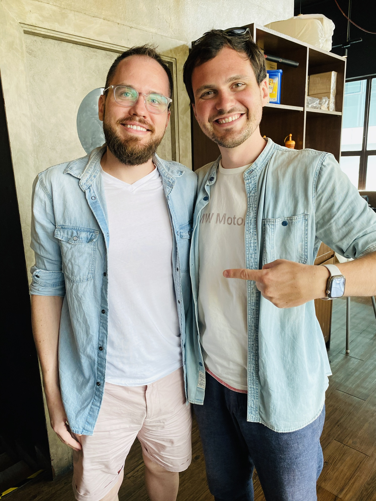



{{ t.about.content | markdownify }}


  

Hi! We're Evandro and Fabio — two brothers from Brazil building apps we genuinely use ourselves. We care a lot about making them useful, simple, and enjoyable. If you have ideas, feedback, or something isn't working right, we'd really love to hear from you.

  <a href="https://www.linkedin.com/in/evandro-harrison-hoffmann" target="_blank">
    <i class="fab fa-linkedin" aria-hidden="true"></i> Evandro
  </a>
  <a href="https://www.linkedin.com/in/fabio-gustavo-hoffmann-03931625" target="_blank">
    <i class="fab fa-linkedin" aria-hidden="true"></i> Fabio
  </a>

---

## What We Build

* Native iOS apps with Swift and SwiftUI — buttery-smooth navigation and custom transitions
* Cross-platform experiences for both iPhone/iPad and Android
* Universal layouts that adapt beautifully across devices and screen sizes
* Widgets, Live Activities, and platform-specific extensions that surface the right info at the right time
* Privacy-first storage with secure sync across devices

## How We Deliver

* Discovery sprints to clarify user needs, product vision, and launch goals
* Interactive prototypes and design systems aligned with platform guidelines
* Modular architectures (MVVM, async/await) and automated testing for confident scaling
* Performance tuning, accessibility audits, and crash monitoring to keep experiences polished
* Launch support — from beta testing to store submissions, release notes, and ASO follow-through

---

Ready to build something magical? [Drop us a message](/contact).


<section class="team" aria-labelledby="team-heading">
  <h2 id="team-heading">The team</h2>
  
A small group behind Magic Lab Solutions.

  

    <article class="team-member">
      EH
      

        <h3>Evandro Harrison Hoffmann</h3>
        
Co-founder

        <a class="team-link" href="https://www.linkedin.com/in/evandro-harrison-hoffmann" target="_blank" rel="noopener">
          <i class="fab fa-linkedin" aria-hidden="true"></i> LinkedIn
        </a>
      

    </article>
    <article class="team-member">
      FH
      

        <h3>Fabio Hoffmann</h3>
        
Co-founder

        <a class="team-link" href="https://www.linkedin.com/in/fabio-gustavo-hoffmann-03931625" target="_blank" rel="noopener">
          <i class="fab fa-linkedin" aria-hidden="true"></i> LinkedIn
        </a>
      

    </article>
    <article class="team-member">
      RP
      

        <h3>Ruchi Parijat</h3>
        
Senior Product Manager

        <a class="team-link" href="https://www.linkedin.com/in/ruchiparijat" target="_blank" rel="noopener">
          <i class="fab fa-linkedin" aria-hidden="true"></i> LinkedIn
        </a>
      

    </article>
  

</section>
